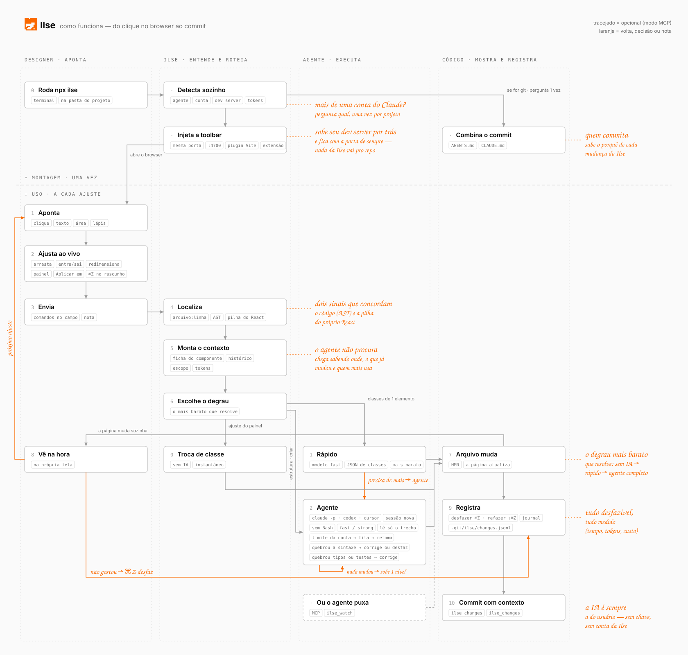

# Como a Ilse funciona

[English](how-it-works.md) · **Português** · [← README](../LEIAME.md)



<sub>Fonte do diagrama: `scripts/architecture-svg.py` (`python3 scripts/architecture-svg.py en` / `pt`).</sub>

1. Seu servidor de desenvolvimento roda como sempre. A Ilse o encontra e serve o mesmo app em `localhost:4700`, com a barra por cima. O hot reload continua funcionando; seu projeto não precisa de nenhum import. Com o [plugin Vite](reference.pt-BR.md#na-porta-do-seu-app-plugin-vite), o próprio servidor de dev carrega a barra; com o [bookmarklet ou a extensão do Chrome](reference.pt-BR.md#qualquer-página-local-bookmarklet-ou-extensão-do-chrome), o navegador. Nos dois casos, sem proxy.
2. Você aponta algo e envia. A Ilse localiza o lugar exato no seu código e monta um pedido curto e preciso.
3. O degrau mais barato que resolve aplica: a própria Ilse, um modelo rápido ou o seu agente completo.
4. O arquivo muda, a página atualiza, e a mudança fica registrada para poder ser desfeita e explicada na hora do commit.

## Por que o agente acerta

Antes de chamar o seu agente, a Ilse faz a busca por ele:

- **Localização exata no código.** O elemento clicado vira `arquivo:linha`, e o agente recebe esse trecho junto com o pedido. Dois sinais independentes precisam concordar: o próprio código (classes, texto, atributos, lidos da AST) e a pilha de desenvolvimento do React (qual componente renderizou, em que arquivo, usado onde). Sem plugin de bundler.
- **Só o trecho necessário.** O agente recebe quais linhas ler, não o arquivo inteiro — um componente de 900 linhas são ~10 mil tokens, reenviados a cada turno.
- **Ficha do componente.** Para um componente reutilizado: onde ele é definido, se aceita `className` e onde é usado.
- **O histórico da própria Ilse.** As últimas mudanças que a Ilse fez no mesmo arquivo vão junto ("decididas pelo designer, mantenha"), para uma correção nova não desfazer uma anterior.
- **Seus tokens de design.** Lidos ao iniciar, de `tailwind.config`, `@theme` do Tailwind v4, variáveis CSS, `tokens.json` do W3C ou um `DESIGN.md` (também o `.ilse/ds/DESIGN.md`, que o Criar DS escreve; formato aberto do Google: os tokens do front matter entram no painel, e o agente é apontado para o arquivo pelas regras), para o agente usar o seu token em vez de um valor fixo. Tokens de degradê (`--brand-gradient: linear-gradient(…)`) aparecem no Fill, numa seção Degradês própria.
- **Só o que importa.** Os estilos são filtrados pela intenção: "cor errada" manda só informação de cor.
- **Suas referências.** Prints colados vão junto; SVGs arrastados são copiados para o projeto como assets.

## O degrau mais barato que resolve

1. **Troca de classe — sem IA.** Uma edição do painel que vira uma classe do Tailwind sem ambiguidade (gap 12px → 16px, peso 500 → 600, uma cor dos seus tokens), ou um texto reescrito que está escrito direto no JSX, é aplicada pela própria Ilse. Na hora, sem tokens. Vale também para uma prop de componente escolhida na seção **Componente** do painel (`variant="outlined"` → `"contained"`, qualquer biblioteca, MUI inclusive) e para um componente arrastado da **Biblioteca** (Pro) quando todas as props têm valor.
2. **Rápido — uma chamada, modelo rápido.** Uma nota sobre um elemento que na verdade é uma troca de classe ("um pouco mais de espaço", "título mais forte") vai para o modelo rápido do seu agente, só com o código daquele elemento e sem ferramentas. Ele responde "tire estas classes, ponha aquelas" e a Ilse aplica. Bem mais barato que o agente, e alguns segundos. Notas que claramente pedem mais ("remover", "trocar o ícone", "um carrossel") vão direto para o agente.
3. **Agente.** Qualquer coisa maior — UI nova, estrutura, vários arquivos — roda o seu agente num modelo do tamanho da tarefa. Se uma execução barata não muda nenhum arquivo, ela é repetida uma vez, um nível acima.

**Modelos.** Dois níveis por agente, `fast` e `strong`; trabalho aberto fica com o padrão do próprio agente. O Claude vem com `haiku` / `sonnet`. Defina os seus em `.ilserc.json`:

```json
{ "models": { "fast": "haiku", "strong": "sonnet" } }
{ "models": { "codex": { "fast": "…", "strong": "…" } } }
```

`ILSE_MODEL=<modelo>` força um modelo para tudo.

**Só este ou todos.** Quando o elemento faz parte de um componente repetido na página, o card pergunta: *só este* (um ajuste onde ele é usado) ou *todos* (a definição do componente). Com *todos*, a prévia já mostra a mudança em todas as instâncias.

## A Biblioteca

O catálogo e o design system numa aba só. **Free** vê e ajusta o que já está na página: a lista, a busca, onde um componente está na página, a seção Componente e o design system escrito como `DESIGN.md`. O **Ilse Pro** coloca componente novo na página (cópias, arrastar, inserir) e leva o DS para outras ferramentas (`tokens.json`, `registry.json`).

Todos os componentes que o produto já tem, lidos do código (sem IA): os do projeto (exportados e usados, ou numa pasta de kit como `components/ui` ou `packages/`) e os da biblioteca que o código importa — não a biblioteca inteira.

- **Achar:** a aba **Biblioteca** do painel (ou o botão da biblioteca na barra, sem nada selecionado). Clicar num componente contorna onde ele está nesta página (ou avisa que não está); clique numa instância para abrir a seção Componente dela. Busca pelo nome ou pelo que o componente faz ("botão", "modal", "button"). Sem busca, **por tipo**: *Base* — bibliotecas, o kit (`components/ui`, pastas compartilhadas) e padrões usados em várias áreas — agrupada pelo que serve (ações, campos, sobreposições, exibição de dados, gráficos…), depois *Produto*, agrupado por área (a pasta dentro de `components/`, ou o grupo de rotas em `app/`). Vem dos nomes e do que cada componente renderiza, sem IA; o que não se encaixa vai para *Outros*. **Por pasta** mostra a organização do código. **Editar organização…** (Pro, no ⋯ ao lado da busca) cria `.ilse/catalog.md` no projeto com as suas áreas listadas: renomeie (`- keys: Keys` → `- keys: Chaves`), mova um componente (`- OwnerBillingField: Produto, Cobrança`) ou oculte (em *Ocultos*). É Markdown simples, versionado com o projeto, e relido toda vez que o catálogo abre. Um design system que o projeto já tem vem primeiro na Base: o `title` das stories no Storybook (`Forms/Input` → grupo *Forms*), a pasta do kit no `components.json` do shadcn, ou uma dependência que se declara design system — esses componentes ficam na Base, com os grupos dele, e mostram *Do design system* no hover. O `.ilse/catalog.md` continua valendo acima de tudo isso. Os componentes desta página levam a etiqueta *na tela*. Passar o mouse mostra as props e os nomes das variantes. Em cima da lista: **Todos**, **Nesta página** (uma lista simples, A→Z) ou **Base**. Os grupos começam fechados; os que você abrir continuam abertos na próxima vez, por projeto.
- **Cópias:** as prévias são cópias do componente como ele apareceu numa página — o HTML com os estilos embutidos, guardado pelo Pro em `~/.ilse/catalog/`, nunca no seu projeto. Elas são tiradas enquanto você usa o app, não só quando o catálogo abre: um diálogo que você abre, a próxima tela — uma por aparência (variante), e um diálogo é copiado pelo painel, não pela camada escura atrás. Um componente que ainda não apareceu diz qual tela o usa, para você abrir.
- **Seção Componente:** selecione um componente na página e Propriedades abre com ele: de onde vem e as props, só com os valores que o código já usa ou o tipo permite (inclusive o `.d.ts` da biblioteca: o `variant` do MUI lista text, outlined, contained). Uma prop não definida mostra o seu padrão quando o código diz qual é (`false (padrão)`, o `defaultVariants` do cva, o `@default` da biblioteca); escolher o padrão tira a prop. Mudar uma delas é escrito no JSX sem IA quando a Ilse acha exatamente aquele uso (no Next 16 com Turbopack também, pelo source map do chunk); senão o seu agente recebe a mudança por escrito. No campo de texto do painel, Enter confirma e Shift+Enter quebra a linha.
- **Use este (Pro):** no card, **+ → Componente…** aponta para o agente qual componente usar (import, como o código o escreve, "não crie outro").
- **Arrastar para a página (Pro):** arraste um componente da biblioteca — ele se move como um elemento que já está na página: a cópia entra de verdade, os itens em volta abrem espaço, o destino fica contornado, e a grade, as guias e as distâncias aparecem. A cópia fica na página como rascunho, com o card em cima — mude as props no painel e confirme. O rascunho continua lá mesmo depois de recarregar, até a mudança ser aplicada. Perto de algo de dentro de um componente seu reutilizado (um rótulo dentro de um card usado em vários lugares), ele entra ao lado desse card onde a página o usa, nunca dentro da definição do card; dentro de uma seção escrita uma vez só, ele cai exatamente onde você soltou. Apagar ou limpar a nota tira o rascunho da página: só uma nota que existe, ou uma mudança aplicada, o mantém.
- **Até a página acompanhar:** o que você viu em prévia — um estilo, uma cópia, um elemento escondido — continua na tela depois que a mudança é aplicada, até a página renderizar de novo com a versão real. Se ela não renderizar sozinha, a Ilse pede ao framework que renderize de novo (App Router do Next: sem recarregar, sem perder o estado). Ela só pede para você recarregar quando a mudança não tem prévia na tela e a página continuou igual.
- **Criar DS:** no topo da Biblioteca, enquanto o projeto não tem `.ilse/ds`: o que foi achado e **Criar design system** (ou `ilse ds`). Depois de criado, o topo mostra **Exportar**, que escreve de novo. Escreve em `.ilse/ds/DESIGN.md` o que o projeto já tem, a partir do código e sem IA: os tokens, os componentes com props, valores, padrões e um exemplo, e regras para agentes. Com Pro, seu agente escreve antes **quando usar** cada componente (uma frase, e quando não usar) — perguntando só pelos componentes novos ou alterados desde a última vez, guardados em `.ilse/ds/state.json`; isso vai para o `DESIGN.md` e para a descrição de cada item do registry. Com Pro, escreve também `tokens.json` (tokens W3C, para o Figma via Tokens Studio ou Style Dictionary) e `registry.json` (formato de registry do shadcn, instalável: cada componente com seus pacotes npm, os componentes do projeto que importa como `@seu-projeto/item`, um item de tema com os tokens, e o contrato em `meta.ilse`). Cite `.ilse/ds/DESIGN.md` no seu `AGENTS.md` e qualquer agente — com ou sem a Ilse rodando — constrói com os seus componentes em vez de inventar outros. Nada é escrito até você pedir. O que foi escrito abre na tela: uma janela com uma aba por arquivo, cada uma dizendo quem lê e como usar — o `DESIGN.md` desenhado como design system (cores, espaço, raio, componentes e variantes) com **Adicionar ao AGENTS.md** (um bloco curto que aponta qualquer agente para o DS — escrito só nesse clique; ou copie a linha), os JSON como foram escritos, copiar e baixar. Sem Pro, as abas JSON mostram uma amostra borrada. Clique no caminho do DS no topo da Biblioteca para abrir de novo. Com Pro o DS fica vivo: quando o código muda (um componente novo, removido ou com props ou valores novos; um token alterado), a Biblioteca diz o que mudou desde que o DS foi escrito, e **Atualizar** escreve de novo — nunca sozinho. O Pro também testa o DS com um **agente sem contexto**: seu agente propõe 3 tarefas reais do produto, um agente que só conhece o `DESIGN.md` faz cada uma, e a Ilse confere o código sem IA (componentes fora do DS, valores de prop que ele não tem, cores e tamanhos à mão). O que ele errar vira regra sugerida; **Adicionar ao DS** põe a regra nas regras para agentes do `DESIGN.md` (guardada no `state.json` entre reescritas). A própria Ilse lê `.ilse/ds/DESIGN.md` como lê o `DESIGN.md` do projeto (o do projeto vence).
- **Duplicar** (grátis): selecione qualquer coisa e **Duplicar** (ao lado de Remover, no pé do painel) põe uma cópia na tela logo depois dela, como rascunho, e diz ao seu agente o que ela significa no código: uma linha de lista vira um novo item nos dados que ela mostra (nunca uma cópia do template, e dado do backend não é inventado); o resto, uma cópia do JSX no mesmo lugar. Com o Pro, a cópia de um componente mantém as props, a variante pode ser trocada antes de confirmar e, com todas as props com valor, é escrita sem IA.

## Telas

**Telas** (o botão de aparelhos na barra) abre a página em que você está na largura de um celular, tablet ou desktop — iPhone 15 (390), iPad Mini (768), Desktop (1280) — um por vez, por cima da página. É o mesmo endereço num iframe: o login e os cookies continuam valendo e os media queries respondem à largura real da tela. Nada muda no seu projeto e o endereço não muda.

- **A mesma barra:** com as Telas abertas, a barra comanda a Ilse de dentro da tela — selecionar, ajustar no painel, desenhar, Run, desfazer. O painel abre fora da tela, então nunca cobre um layout de 390px. O ajuste vai para o código e o hot reload atualiza a tela.
- **Tamanho:** os aparelhos ficam lado a lado no topo; o celular gira para paisagem. Arraste a borda direita ou de baixo da tela (ou o canto) para qualquer tamanho no meio — *Livre*.
- **Réguas** em cima e à esquerda, nos pixels da própria tela; o elemento selecionado aparece nelas em laranja.
- **Selecionar / navegar:** o botão de seleção da barra alterna entre escolher elementos e usar o app (links, menus). A seleção volta depois que uma mudança é aplicada.
- **App que recusa iframe** (`X-Frame-Options`, `frame-ancestors`): pelo endereço da Ilse (mesma porta ou `--separate`) esses cabeçalhos saem só no carregamento da tela. Fora disso, as Telas avisam.

## Mantendo seu projeto seguro

- **O agente roda isolado.** Sem o seu `CLAUDE.md` pessoal nem memória — só as instruções do próprio projeto. Sem shell: ele lê e edita arquivos, mais nada.
- **A mudança tem que cair nesta página.** Todo pedido leva a página em que foi feito. Depois do run, a Ilse compara os componentes que o agente editou com os que aparecem na página; se nenhum estiver nela, a barra diz qual arquivo mudou e onde ele é usado, com **Refazer nesta página**, **Desfazer** e **Manter** — em vez de só "concluído".
- **A página não pode quebrar.** Depois de uma mudança, a barra presta atenção nos erros que a página registra (keys repetidas do React, uma exceção não tratada) e que não existiam antes. Se aparecer um, ela mostra, com **Pedir correção** (o erro vai para o seu agente), **Desfazer** e **Ignorar**.
- **O código é conferido depois do agente.** Como o agente não consegue fazer o build do projeto, a Ilse lê cada arquivo que ele mudou. Se algum deixou de compilar, o agente ganha um turno para corrigir exatamente aquele erro; se continuar quebrado, o lote inteiro é desfeito e o card mostra onde.
- **As prévias não mexem na estrutura do React.** Arrastes e edições do painel aparecem com estilos e substitutos; cancelar uma nota devolve a página como estava.

## Passar no CI

Uma mudança de design pode quebrar o que o CI roda: uma prop usada e nunca declarada, um teste que fixa a aparência antiga, um "mostre só 10 linhas" que mudou o limite de que o backend depende. Por isso, depois de cada mudança — agente, passo rápido ou troca de classe — a Ilse roda as checagens do próprio projeto antes de dizer que terminou:

1. **Typecheck.** `tsc --noEmit`, incremental (o cache fica em `.git/ilse/`). Só contam erros nos arquivos que a mudança tocou ou em arquivos que os importam.
2. **Os testes que cobrem a mudança.** `vitest related` ou `jest --findRelatedTests` nos arquivos alterados — segundos, não a suíte inteira.
3. **Só o que passava antes.** O que falha roda de novo no projeto como estava antes da mudança — uma cópia fora do seu projeto (`git archive` do HEAD, seu trabalho não commitado por cima, os arquivos da mudança de volta ao que eram, `node_modules` linkado). Uma falha que já existia — trabalho de outro agente na mesma branch, um teste já vermelho — nunca é atribuída à mudança.
4. **O agente corrige.** O que a mudança quebrou volta para o agente, junto com o pedido do designer, que ele tem que manter. As regras: um teste que fixa a aparência (texto, classe, cor, marcação) e falhou porque a aparência mudou de propósito é atualizado para a nova aparência; um teste de comportamento (paginação, limites, permissões, requisições, estado) fica, e o código é corrigido para manter o comportamento e ainda entregar a aparência pedida; um erro de tipo é corrigido no código.
5. **Confere de novo.** Até dois turnos de correção. Uma correção que apaga, pula ou afrouxa um teste não vale: a Ilse compara os testes e as asserções de antes e depois.
6. **Continua vermelho?** A mudança fica e a barra diz o que ainda falha, com **Desfazer** e **Manter mesmo assim**. O terminal lista cada falha.

Antes de tudo isso, o agente fica sabendo quais testes cobrem o arquivo que vai mudar, então uma mudança de aparência costuma atualizar o teste na mesma passada. Ele também é instruído a mudar só a apresentação — constantes compartilhadas, limites, dados e lógica ficam como estão — e a usar os tokens do projeto.

Com MCP, seu agente conduz os próprios turnos: quando ele resolve a última anotação de um lote, o `ilse_resolve` responde com o que quebrou, e o agente corrige e resolve de novo.

Caminhos que o projeto muda de outro jeito (uma cópia vendorizada que um script aplica patches, código gerado) podem ser marcados no `.ilserc.json` → `protected`: o agente é avisado para não editá-los, e uma edição ali conta como falha a corrigir. Configurações: [Referência → Checagens do projeto](reference.pt-BR.md#checagens-do-projeto).

## Desfazer

O ⌘Z funciona em dois níveis:

- **Enquanto você ajusta** (o card está aberto): o ⌘Z volta passo a passo naquele rascunho — um valor do painel, um arraste, um redimensionamento — só na tela. Ele nunca mexe em arquivos que você já aplicou.
- **Depois de aplicado:** ⌘Z (ou **Desfazer** na barra) restaura os arquivos da última mudança, da mais nova para a mais antiga; ⇧⌘Z refaz. Não precisa pedir para a IA reverter.
- **Depois de reiniciar:** o histórico de desfazer fica guardado por projeto na pasta da própria Ilse (`~/.ilse/projects/…/undo.json`, nunca no seu projeto), então fechar o `ilse` não faz você perdê-lo. `ILSE_UNDO_SAVE=0` mantém só em memória.

O atalho não interfere enquanto você digita. Arquivos que você editou de novo depois ficam como estão, e a anotação volta para pendente, para você ajustar e reenviar.

## Quando o agente bate no limite de uso

A Ilse roda na conta do seu agente e divide os limites dela. No Claude, claude.ai, o app Desktop e o Claude Code contam para o mesmo limite **na mesma conta**. Se o Desktop continua funcionando enquanto a Ilse está limitada, são contas diferentes — veja [Qual conta do Claude](reference.pt-BR.md#qual-conta-do-claude-a-ilse-usa).

Quando o limite chega:

- **Você vê o motivo:** a mensagem do próprio agente ("You've hit your session limit · resets 7:30pm") e a conta.
- **Nada se acumula falhando:** a Ilse para de chamar o agente até o horário de renovação.
- **As anotações esperam e voltam sozinhas** logo depois da renovação. (A fila vive no `ilse` em execução; se você reiniciar antes, elas voltam para pendentes.)
- **Edições do painel continuam funcionando** — a troca de classe não usa o agente.

Para seguir antes da renovação: troque de conta (`--account`) ou use o modo área de transferência.

## Modo teste na barra

Com o Ilse Pro, a chave Design / Teste transforma a barra no testador. **Rodar teste** (os óculos, o botão principal do modo teste, onde o design tem o ⚡) primeiro pergunta o que testar: jornadas, acessibilidade, erros técnicos, layout e consistência, cada um com uma chave, e em quais telas (computador, tablet, celular). As telas já vêm do próprio app (breakpoints no código querem dizer celular também); quando o código não diz, a Ilse pergunta uma vez se o app precisa funcionar no celular. A última escolha fica lembrada. Depois um agente percorre o app num navegador à parte, enquanto os óculos piscam. O que ele acha na página aberta vira marcadores azuis nos elementos, cada um com a nota já escrita. Clique num marcador para mudar a nota e depois **Pular** (volta no próximo teste), **Ignorar sempre** (a Ilse não avisa mais) ou **Corrigir** (vai para o seu agente agora; a Ilse testa a página de novo depois da correção). Achados sem elemento para apontar, como um erro no console, ficam no relatório, mas sem marcador. Nada entra numa fila sozinho: um achado só vai para o agente quando você corrige. O olho esconde os marcadores. Notas de design e marcadores de teste ficam separados: cada modo mostra e executa os seus.

**O relatório** (o botão de lista) abre ao lado quando o teste termina, compacto — grupos fechados, um clique abre cada um; o ⤢ expande para o centro da página. Ele mostra um número por grupo (jornadas concluídas, erros, melhorias, código repetido) e o que mudou desde o último teste, depois os achados de cada grupo. Erro é o que quebra alguma coisa; o resto é melhoria. Clique num item e, enquanto você navega, ele abre a página do item, rola até o elemento e contorna ele (todas as cópias, quando é código repetido) e mostra o detalhe, os arquivos e linhas e as jornadas que passam por ali. Em cada item, os mesmos três do marcador: **Pular**, **Ignorar sempre** (desfeito na Memória do projeto) ou **Corrigir**. No rodapé, compacto ou expandido: **Rodar de novo** e **Corrigir todos**; **Ignorar todos** fica no menu ⋯, com confirmação. Um grupo que você desligou mantém os achados do teste anterior, marcados assim.

**Consistência** lê o código, sem IA: o mesmo elemento escrito à mão em vários lugares (2 é um achado menor, 3 ou mais é maior), componentes de uma mesma pasta que divergiram (raio, espaçamento, fundo) e valores espalhados demais (raios, sombras, cores escolhidas à mão). Um kit de componentes, como o `packages/` de um monorepo ou o `components/ui` do app, conta como o que já existe: "5 lugares recriam à mão um botão; o projeto já tem Button". Com um design system escrito (Criar DS), os componentes dele também contam, e os tokens viram a regra: "#ff6c03 escrito à mão em 10 lugares; o design system tem o token brand", com cada lugar.

**Jornadas** (o botão de rota): descreva algo que uma pessoa faz no seu app — "criar uma chave e copiar o token" — e a Ilse percorre num navegador à parte, começando na página aberta. O seu agente escolhe cada passo pelo que um leitor de tela veria; a Ilse clica e digita, mostra cada passo enquanto anda e guarda os passos que deram certo. Daí em diante a jornada repete sem IA, em segundos. Se a tela mudou, o agente acha o caminho de novo a partir do passo que quebrou; se não achar, a jornada trava e diz onde e por quê. Ela também roda numa tela de celular, e guarda o caminho próprio do celular quando é outro. Antes de um clique que não tem volta (excluir, cancelar, pagar, sair) e que você não pediu, a Ilse para e pergunta. `ilse journeys` faz o mesmo no terminal, e `ilse test` repete as gravadas no final. Gravar precisa do Claude Code; repetir, não. Sem nenhuma jornada ainda, **Sugerir jornadas lendo o código** faz o seu agente ler as páginas do app e propor de 3 a 5; marque as que quiser e **Gravar N** grava uma depois da outra (as outras voltam quando termina). A jornada fica na sua máquina; o ícone de pasta salva no projeto (`.ilse/journeys.md`, com os passos legíveis) para o time repetir também, e o painel avisa quando a sua cópia achou um caminho novo que o arquivo do projeto ainda não tem.

**O relatório de uma jornada.** Ao abrir o botão de rota com jornadas, a Ilse oferece rodar de novo a última ou começar uma nova. Quando uma execução termina, **Ver relatório** abre o relatório na aba **Jornadas** (clicar numa jornada no painel, ou na linha dela no relatório do teste, faz o mesmo): cada jornada com o último resultado e as últimas 5 execuções em pontinhos, para ver quando começou a quebrar. Abra uma e aparecem os passos: ✓ com o tempo de cada um, ✗ no que quebrou, com o motivo e um print da página naquele momento, e o resto em cinza — computador e celular lado a lado quando rodou nos dois. Dali: **Rodar de novo**, **Copiar log** (texto para colar em qualquer agente), **Baixar** (uma página HTML com os passos e o print) e, quando travou, **Corrigir** (uma nota na página onde parou, enviada ao seu agente). As execuções e os prints ficam na sua máquina.

## Memória do projeto

Configurações → **Memória do projeto** mostra tudo o que a Ilse lembra deste projeto — nada fica guardado sem aparecer ali:

- **Mudanças de design** (grátis): as mudanças que a Ilse fez aqui e ficaram, da mais nova para a mais antiga, com a sua nota, os arquivos e quais ainda estão sem commit. Quando o agente mexe num desses arquivos, ele recebe as últimas mudanças feitas ali e o motivo de cada uma.
- **Modo teste** (Ilse Pro): quantos testes rodaram, os achados que ainda estão lá, os corrigidos e os que voltaram depois de corrigidos (um clique abre a página), o que você pediu para ignorar — com **Voltar a avisar** para desfazer — e onde as checagens acertam ou são ruído, pelas suas decisões. **Esquecer a memória do teste** apaga tudo depois de confirmar (o mesmo que `ilse memory --forget`). Sem o Pro, a seção diz o que ela guardaria.

## Os commits sabem o que a Ilse mudou

As edições da Ilse chegam por outro processo, então a sessão que faz o commit depois não as fez. A Ilse mantém um registro em `.git/ilse/changes.jsonl` (por clone, nunca vai para o commit): para cada lote, a nota do designer, as edições do painel e os arquivos.

- `ilse changes` mostra o que a Ilse mudou e ainda não foi commitado, pronto para a mensagem de commit (também como a ferramenta MCP `ilse_changes`).
- Na primeira execução num repositório git, a Ilse pede para adicionar uma nota curta no seu `AGENTS.md` / `CLAUDE.md`, dizendo ao seu agente para incluir essas mudanças.
